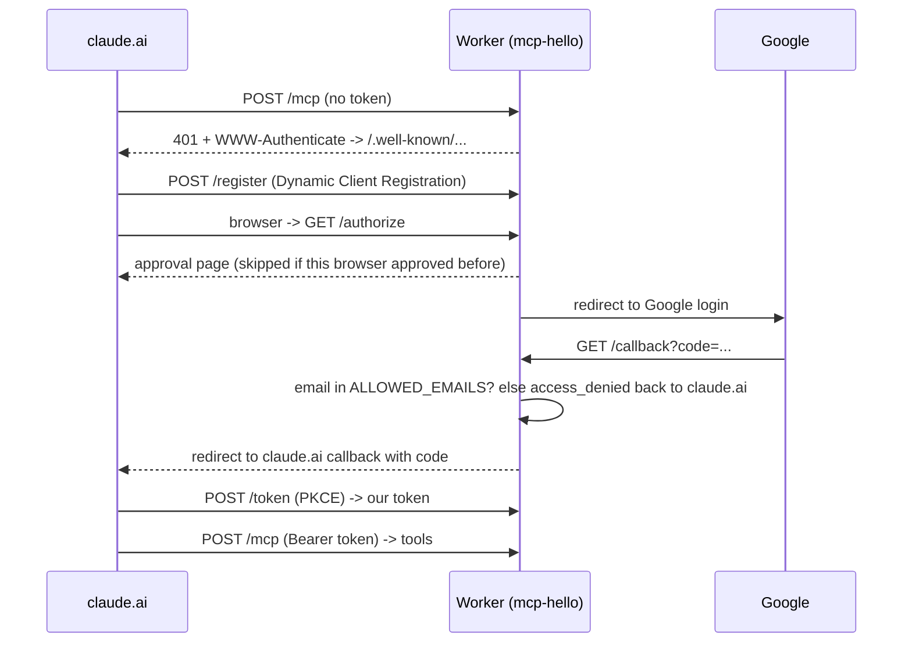

# remote-mcp-template

Your own remote MCP servers on Cloudflare Workers, connectable from claude.ai (web, desktop and mobile) as custom connectors.
Login goes through Google and an email allowlist, so only you get in.

A server is a file of tools.
The OAuth plumbing claude.ai expects lives in one shared package, and a few scripts take a new server from folder to connector URL.

```ts
export default withGoogleAuth(() => {
	const server = new McpServer({ name: "notes", version: "0.1.0" });
	server.registerTool("whoami", { description: "Who am I logged in as", inputSchema: z.object({}) },
		async () => ({ content: [{ type: "text", text: currentUser()!.email }] }));
	return server;
}, { name: "notes", description: "shown on the approval page" });
```

## What I use it for

- **A large dbt project.** A big analytics codebase with all its models and docs is far more than a Claude Project's knowledge can hold, and stuffing in a subset loses the rest. As an MCP server with search and read tools, Claude looks up the handful of models a question needs, across the whole project.
- **My LLM wiki.** My personal knowledge base lives on a Mac mini at home, which Claude on my phone cannot reach. A Worker serves a synced copy from D1 with full-text search, plus a capture tool that writes new notes back. Now it is one connector away, from anywhere.
- **[Fridge Door](https://github.com/duke8585/fridge-door).** A household recipe app that exposes its own MCP server, so Claude can search recipes and fill the shopping list. It uses the same libraries with the app's own login instead of Google, a good reference if you want to bolt MCP onto an existing app.

The two search-shaped cases are what `servers/notes-search` sketches. It is a D1 table with an FTS5 index and `search`, `read_note` and `add_note` tools.

## How claude.ai connects



The Worker plays two OAuth roles.
Towards claude.ai it is the **authorization server** and mints its own tokens.
Towards Google it is a **client**, used once per login to learn your email.
claude.ai never sees a Google token, and the Worker drops the Google token right after reading the email.

All of the OAuth state lives in [`@cloudflare/workers-oauth-provider`](https://github.com/cloudflare/workers-oauth-provider): client registration, the consent handle, the state sent to Google, the "remember this approval" cookie, codes and tokens.
`packages/auth/src/google.ts` only renders the approval page and talks to Google, so there is no hand-rolled CSRF or state handling to get wrong.

The pieces on Cloudflare:

| Piece | Role |
|---|---|
| Worker | one per server, one connector URL each (`https://mcp-<name>.<subdomain>.workers.dev/mcp`) |
| KV namespace `OAUTH_KV` | registered clients, grants, tokens and in-flight logins, managed by the OAuth provider library |
| Secrets | `GOOGLE_CLIENT_ID`, `GOOGLE_CLIENT_SECRET`, `ALLOWED_EMAILS`, `CONSENT_SECRET` |
| D1 (optional) | your data, e.g. the FTS5 index in `notes-search` |

MCP runs over **Streamable HTTP** on a single `/mcp` endpoint, statelessly.
Each request builds a fresh `McpServer` (`createMcpHandler` from [`agents`](https://www.npmjs.com/package/agents)), so there are no Durable Objects and no sessions to manage.

### The lines claude.ai needs

Search for `CLAUDE.AI #` in `packages/auth/src/`:

| Marker | Where | What claude.ai relies on |
|---|---|---|
| `#1` | `index.ts` `apiRoute` | `/mcp` answers 401 + `WWW-Authenticate` without a token, which is how claude.ai discovers it must do OAuth |
| `#2` | `index.ts` `clientRegistrationEndpoint` | claude.ai registers itself, so there is no client id to paste anywhere |
| `#3` | `index.ts` `authorizeEndpoint`, `tokenEndpoint` | standard OAuth endpoints, advertised at `/.well-known/oauth-authorization-server` |
| `#4` | `google.ts` `completeAuthorization` | after your login, redirect back to claude.ai with an auth code |
| `#5` | `index.ts` `resourceMetadata` | tokens are bound to `MCP_RESOURCE`, which must equal the URL you paste into claude.ai |

Everything else (Google, the allowlist, the approval page) is our choice of *who may log in* and invisible to claude.ai.
Swap `google.ts` for another identity provider (GitHub, your own login) and the claude.ai side does not change.

## Quickstart

You need Node 22+, a Cloudflare account (the free plan is fine) and a Google account.

```text
npm install
npx wrangler login
scripts/provision.sh hello <subdomain>    # creates KV, fills in wrangler.jsonc, prints the redirect URI
```

`<subdomain>` is your account's `*.workers.dev` subdomain, shown under **Workers & Pages** in the Cloudflare dashboard.
On a brand-new account, open **Workers & Pages** once first, so Cloudflare asks you to pick one.

Then create the Google OAuth client, following **[docs/google-oauth.md](docs/google-oauth.md)**, and finish:

```text
scripts/set-secrets.sh hello ~/Downloads/client_secret_XXXX.json   # deploys, sets secrets, prompts for allowed emails
scripts/smoke.sh hello                                              # /mcp answers 401, OAuth metadata is served
```

In claude.ai, open **Settings -> Connectors -> Add custom connector** and paste `https://mcp-hello.<subdomain>.workers.dev/mcp`.
Connect, approve, log in with Google, and ask Claude to call `whoami`.
Connectors added on the web show up in the desktop and mobile apps too.

## Add a server

```text
scripts/new-server.sh notes [notes-search]   # copy hello (or another server) to servers/notes
edit servers/notes/src/index.ts               # your tools
scripts/provision.sh notes <subdomain>        # KV (+ D1 and its migrations if the server has one)
# Google console: add https://mcp-notes.<subdomain>.workers.dev/callback to the same client
scripts/set-secrets.sh notes ~/Downloads/client_secret_XXXX.json
```

One Google client serves every server, with one redirect URI per server.
Each server gets its own Worker, KV namespace and connector.

### Writing tools

- **Input schemas are zod.** Add `.describe()` to fields. Claude reads the descriptions to decide what to pass.
- **Say whether a tool writes.** `annotations: { readOnlyHint: true }` tells clients a tool only reads, which they can use when deciding what to confirm with you. Mark writes with `readOnlyHint: false` and, if they overwrite or delete, `destructiveHint: true`.
- **Return errors, don't throw them.** `{ content: [...], isError: true }` with a sentence on how to recover ("use search to find paths") lets Claude retry sensibly.
- **Bindings come from `cloudflare:workers`.** `import { env } from "cloudflare:workers"` gives you D1, KV, R2 and secrets inside tools. Add the binding to `wrangler.jsonc`.
- **`currentUser()`** returns the logged-in Google name and email, for per-user data or audit trails.
- **Keep results small.** Return excerpts and ids from search, and a separate read tool for full documents, as `notes-search` does. That is the whole trick that makes large corpora usable.

### Loading notes into `notes-search`

```text
node servers/notes-search/load.mjs ~/notes > notes.sql             # add and update
node servers/notes-search/load.mjs --mirror ~/notes > notes.sql    # also delete notes whose file is gone
cd servers/notes-search && npx wrangler d1 execute mcp-notes-search --remote --file ../../notes.sql
```

The default mode keeps notes saved through `add_note`, while `--mirror` makes the index match the folder exactly.
Files over D1's 100 KB statement limit are skipped with a warning.

## Change who can log in

```text
cd servers/hello && npx wrangler secret put ALLOWED_EMAILS    # prompts for the new comma-separated list
```

The allowlist is re-checked on every request, so a removed email loses access immediately, including tokens issued earlier.
No redeploy and no client JSON needed.

## Local development

```text
cd servers/hello
cp .dev.vars.example .dev.vars    # MCP_RESOURCE=http://localhost:8787/mcp plus your Google client
npm run dev                        # http://localhost:8787
```

`.dev.vars` overrides `wrangler.jsonc` and stands in for secrets.
For a real Google login locally, add `http://localhost:8787/callback` as a redirect URI in the Google client.
claude.ai cannot reach localhost, so connect a local client instead, e.g. [MCP Inspector](https://github.com/modelcontextprotocol/inspector) (`npx @modelcontextprotocol/inspector`) or Claude Code (`claude mcp add --transport http hello http://localhost:8787/mcp`).

## Checks

| Command | What it proves |
|---|---|
| `npm run type-check` | all workspaces compile |
| `scripts/check-auth.sh [base-url]` | against a running server (default `npm run dev`), drives the OAuth flow as a fake client: registration, approval page, cancel, remembered approval, single-use state, Google errors routed back to the client, HTML escaping. 14 checks, Google credentials can be fake |
| `scripts/smoke.sh <server>` | the deployed server answers claude.ai's first two requests correctly |

Run `check-auth.sh` after any change to `packages/auth`.

## Security notes

- **The allowlist fails closed.** A Google login only proves "has a Google account". `ALLOWED_EMAILS` is the actual access control. An empty list lets nobody in, and it is re-checked on every `/mcp` request.
- **The approval page stays.** Anyone can register a client via `/register`. Without the approval click, a malicious client could send you a link and, since you are already logged into Google, silently receive a token for your account. The page shows where the browser will be sent and warns about localhost redirects.
- **Approvals are remembered per browser** for 30 days in a cookie signed with `CONSENT_SECRET`, and only for the same client, redirect URI and scopes. `set-secrets.sh` creates the secret once and keeps it on re-runs. Rotating it forces everyone to approve again.
- **Request state is never rebuilt from user input.** Every authorization request passed to the provider comes from the provider itself (`parseAuthRequest`, `approveConsent`, `finishUpstream`), and consent handles and upstream state are single use and bound to the browser.
- **One KV per server.** Tokens are bound to one server's URL anyway, and separate KV keeps revocation simple (delete the namespace).
- **Secrets never touch the command line.** `set-secrets.sh` pipes every value over stdin and prompts for the allowlist.

## Costs and limits

For personal use this stays within the Workers free plan: 100k requests a day, KV and D1 free tiers.
Each login writes a handful of KV keys, and tool calls only read KV.
D1 free tier allows 100k row writes a day, so bulk loads of very large corpora are better done on Workers Paid.
Check [Cloudflare's pricing](https://developers.cloudflare.com/workers/platform/pricing/) for current numbers.

## Layout

```text
packages/auth/          withGoogleAuth(), currentUser(), approval page, Google login, allowlist
servers/hello/          whoami + add, the smallest possible server
servers/notes-search/   D1 + FTS5 search over notes, with a Markdown loader
scripts/                new-server, provision, set-secrets, smoke, check-auth
docs/google-oauth.md    the Google Cloud walkthrough
```

## License

MIT, see [LICENSE](LICENSE).
