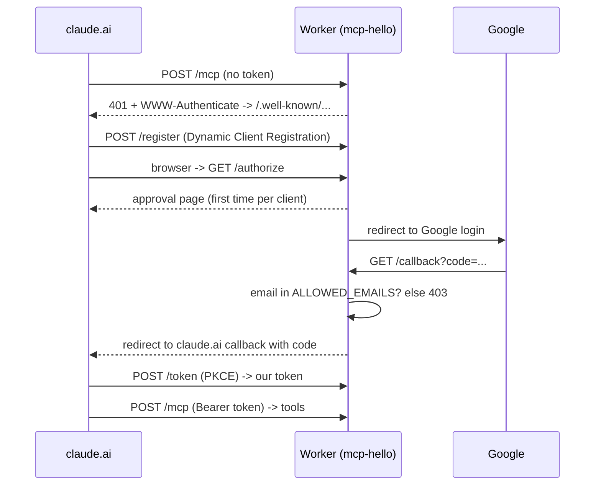

# remote-mcp-template

Your own remote MCP servers on Cloudflare Workers, connectable from claude.ai (web, desktop and mobile) as custom connectors.
Login goes through Google and an email allowlist, so only you get in.

A server is a file of tools.
The OAuth plumbing claude.ai expects lives in one shared package, and three scripts take a new server from folder to connector URL.

```ts
export default withGoogleAuth(() => {
	const server = new McpServer({ name: "notes", version: "0.1.0" });
	server.registerTool("whoami", { description: "Who am I logged in as", inputSchema: z.object({}) },
		async () => ({ content: [{ type: "text", text: currentUser()!.email }] }));
	return server;
}, { name: "notes", description: "shown on the approval page" });
```

## What I use it for

- **A large dbt project.** Hundreds of models and their docs are far more than a Claude Project's knowledge can hold, and stuffing in a subset loses the rest. As an MCP server with search and read tools, Claude looks up the handful of models a question needs, across the whole project.
- **My LLM wiki.** My personal knowledge base lives on a Mac mini at home, which Claude on my phone cannot reach. A Worker serves a synced copy from D1 with full-text search, plus a capture tool that writes new notes back. Now it is one connector away, from anywhere.
- **[Fridge Door](https://github.com/duke8585/fridge-door).** A household recipe app that exposes its own MCP server, so Claude can search recipes and build the shopping list. It uses the same libraries with the app's own login instead of Google, a good reference if you want to bolt MCP onto an existing app.

The two search-shaped cases are what `servers/notes-search` sketches: a D1 table, an FTS5 index, and `search` / `read_note` / `add_note` tools.

## How claude.ai connects



The Worker plays two OAuth roles.
Towards claude.ai it is the **authorization server** and mints its own tokens.
Towards Google it is a **client**, used once per login to learn your email.
claude.ai never sees a Google token, and the Worker drops the Google token right after reading the email.

The pieces on Cloudflare:

| Piece | Role |
|---|---|
| Worker | one per server, one connector URL each (`https://mcp-<name>.<subdomain>.workers.dev/mcp`) |
| KV namespace `OAUTH_KV` | registered clients, grants and tokens, managed by [`@cloudflare/workers-oauth-provider`](https://github.com/cloudflare/workers-oauth-provider) |
| Secrets | Google client id and secret, `ALLOWED_EMAILS`, `COOKIE_ENCRYPTION_KEY` |
| D1 (optional) | your data, e.g. the FTS5 index in `notes-search` |

MCP runs over **Streamable HTTP** on a single `/mcp` endpoint, statelessly.
Each request builds a fresh `McpServer` (`createMcpHandler` from [`agents`](https://www.npmjs.com/package/agents)), so there are no Durable Objects and no sessions to manage.
All of this fits in the Workers free plan for personal use.

### The lines claude.ai needs

Search for `CLAUDE.AI #` in `packages/auth/src/`:

| Marker | Where | What claude.ai relies on |
|---|---|---|
| `#1` | `index.ts` `apiRoute` | `/mcp` answers 401 + `WWW-Authenticate` without a token, which is how claude.ai discovers it must do OAuth |
| `#2` | `index.ts` `clientRegistrationEndpoint` | claude.ai registers itself, so there is no client id to paste anywhere |
| `#3` | `index.ts` `authorizeEndpoint`, `tokenEndpoint` | standard OAuth endpoints, advertised at `/.well-known/oauth-authorization-server` |
| `#4` | `google.ts` `completeAuthorization` | after your login, redirect back to claude.ai with an auth code |
| `#5` | `index.ts` `resourceMetadata` | tokens are bound to `MCP_RESOURCE`, which must equal the URL you paste into claude.ai |

Everything else (Google, the allowlist, the approval page) is our choice of *who may log in* and invisible to claude.ai.
Swap `google.ts` for another identity provider and the claude.ai side does not change.

## Quickstart

You need Node 22+, a Cloudflare account (free plan is fine) and a Google account.

```text
npm install
npx wrangler login
scripts/provision.sh hello <subdomain>    # creates KV, fills in wrangler.jsonc, prints the redirect URI
```

`<subdomain>` is your account's `*.workers.dev` subdomain, shown under **Workers & Pages** in the Cloudflare dashboard.

Then create the Google OAuth client, following **[docs/google-oauth.md](docs/google-oauth.md)**, and finish:

```text
scripts/set-secrets.sh hello ~/Downloads/client_secret_XXXX.json you@gmail.com   # deploys + sets secrets
scripts/smoke.sh hello                                                            # 401 on /mcp, metadata OK
```

In claude.ai, open **Settings -> Connectors -> Add custom connector** and paste `https://mcp-hello.<subdomain>.workers.dev/mcp`.
Connect, approve, log in with Google, and ask Claude to call `whoami`.
Connectors added on the web show up in the desktop and mobile apps too.

## Add a server

```text
scripts/new-server.sh notes [notes-search]   # copy hello (or another server) to servers/notes
edit servers/notes/src/index.ts               # your tools
scripts/provision.sh notes <subdomain>        # KV (+ D1 if the server has one)
# Google console: add https://mcp-notes.<subdomain>.workers.dev/callback to the client
scripts/set-secrets.sh notes ~/Downloads/client_secret_XXXX.json you@gmail.com
```

For `notes-search`, fill the index from a folder of Markdown:

```text
node servers/notes-search/load.mjs ~/notes > notes.sql
cd servers/notes-search && npx wrangler d1 execute mcp-notes-search --remote --file ../../notes.sql
```

## Day to day

```text
npm run type-check                       # all workspaces
cd servers/hello && npx wrangler deploy  # deploy one server
cd servers/hello && npx wrangler tail    # live logs (rejected logins show as "login rejected")
```

## Security notes

- **The allowlist fails closed.** A Google login only proves "has a Google account". `ALLOWED_EMAILS` is the actual access control, an empty list lets nobody in, and it is re-checked on every `/mcp` request, so removing an email locks out tokens already issued.
- **The approval page stays.** Anyone can register a client via `/register`. Without the approval click, a malicious client could send you a link and, since you are already logged into Google, silently receive a token for your account.
- **One KV per server.** Tokens are bound to one server's URL anyway, and separate KV keeps revocation simple (delete the namespace).
- **Secrets go in over stdin.** `set-secrets.sh` never puts a secret on the command line.

## Layout

```text
packages/auth/          withGoogleAuth(), currentUser(), Google login + allowlist
  src/workers-oauth-utils.ts   approval page, CSRF, state (vendored from Cloudflare, unchanged)
servers/hello/          whoami + add, the smallest possible server
servers/notes-search/   D1 + FTS5 search over notes, with a Markdown loader
scripts/                new-server, provision, set-secrets, smoke
docs/google-oauth.md    the Google Cloud walkthrough
```

## License

MIT. `packages/auth/src/workers-oauth-utils.ts` is from [cloudflare/ai](https://github.com/cloudflare/ai) (MIT), see [LICENSE](LICENSE).
